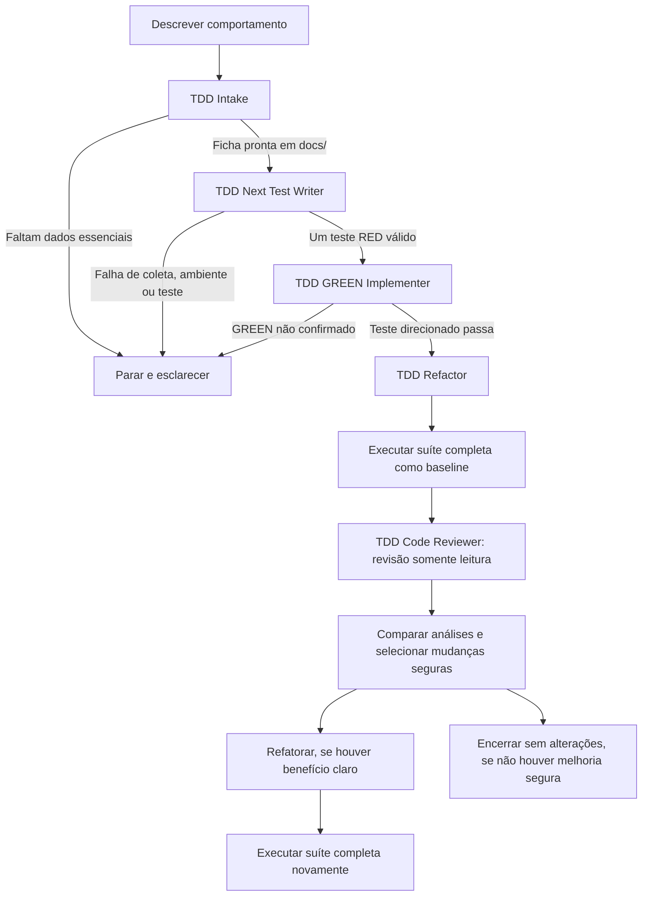

# Agentes TDD

Este diretório contém agentes e skills para conduzir ciclos de desenvolvimento orientado por testes (TDD) em Python. O fluxo mantém as etapas separadas: cada agente executa apenas seu papel e interrompe o processo quando a etapa anterior não foi validada.

## Fluxo recomendado

Para conduzir um ciclo completo, selecione **TDD Orchestrator** no seletor de agentes do Copilot e descreva o comportamento desejado e o projeto-alvo.

O orquestrador deve parar no primeiro bloqueio. Não se deve avançar para GREEN sem um teste RED funcional, nem iniciar Refactor sem GREEN confirmado.

## Agentes

| Agente | Responsabilidade | Skill principal |
| --- | --- | --- |
| [TDD Orchestrator](agents/tdd-orchestrator.agent.md) | Coordena Intake → Test Writer → GREEN → Refactor, mantendo as validações e limites de cada etapa. | [tdd-orchestrator](skills/tdd-orchestrator/SKILL.md) |
| [TDD Intake](agents/tdd-intake.agent.md) | Coleta comportamento, cenários, próximo cenário, contexto do teste e restrições; salva uma ficha datada em `docs/`. | Combina as cinco skills de intake abaixo. |
| [TDD Next Test Writer](agents/tdd-test-writer.agent.md) | Lê a ficha pronta, escreve somente um teste unitário pytest e valida o RED direcionado. | [tdd-write-next-test](skills/tdd-write-next-test/SKILL.md) |
| [TDD GREEN Implementer](agents/tdd-green-implementer.agent.md) | Confirma que o teste falha por comportamento ausente e implementa o menor delta de produção para fazê-lo passar. | [tdd-green-next](skills/tdd-green-next/SKILL.md) |
| [TDD Refactor](agents/tdd-refactor.agent.md) | Após GREEN, executa a suíte completa antes e depois, compara sua análise com a revisão independente e aplica apenas refatorações seguras. | [tdd-refactor-green](skills/tdd-refactor-green/SKILL.md) |
| [TDD Code Reviewer](agents/tdd-code-reviewer.agent.md) | Fornece revisão independente e somente leitura; não altera arquivos nem executa comandos. | É delegado pelo TDD Refactor. |

## Skills de Intake

O agente **TDD Intake** usa estas skills para organizar a descoberta sem decidir detalhes de implementação:

- [Comportamento desejado](skills/tdd-intake-behavior/SKILL.md) — registra o resultado observável.
- [Lista inicial de cenários](skills/tdd-intake-scenarios/SKILL.md) — identifica variações, limites e lacunas.
- [Próximo cenário](skills/tdd-intake-next-test/SKILL.md) — seleciona exatamente um cenário para o próximo ciclo.
- [Contexto do teste](skills/tdd-intake-test-context/SKILL.md) — especifica fronteira pública, preparação, invocação e resultado observável.
- [Restrições técnicas](skills/tdd-intake-constraints/SKILL.md) — registra linguagem, ambiente e requisitos de validação confirmados.

## Limites por etapa

1. **Intake:** coleta e grava a ficha; não escreve testes nem implementação. Se não houver `docs/` no projeto, pergunta onde salvar a ficha.
2. **RED:** o Test Writer cria exatamente um teste focado para a API pública e para código ainda não implementado. Erros de importação, coleta ou ambiente não contam como RED funcional.
3. **GREEN:** o Implementer altera somente produção para passar o teste direcionado; para assim que o teste fica verde.
4. **Refactor:** acontece depois de GREEN. O Reviewer é somente leitura, e mudanças são opcionais; testes não são alterados nesta etapa.

## Como usar as etapas separadamente

As etapas também podem ser solicitadas individualmente pelo seletor de agentes do Copilot, desde que as pré-condições sejam atendidas:

- **TDD Intake:** descreva o comportamento e indique o projeto.
- **TDD Next Test Writer:** use depois que a ficha em `docs/YYYY-MM-DD-tdd-intake.md` estiver marcada `PRONTO_PARA_TDD: SIM`.
- **TDD GREEN Implementer:** use após um teste RED direcionado e funcional.
- **TDD Refactor:** use somente após GREEN confirmado.
- **TDD Code Reviewer:** use para uma revisão somente leitura de um escopo Python.

Para um ciclo completo, prefira o **TDD Orchestrator**; ele coordena as chamadas especializadas e interrompe o fluxo quando uma pré-condição falha.
