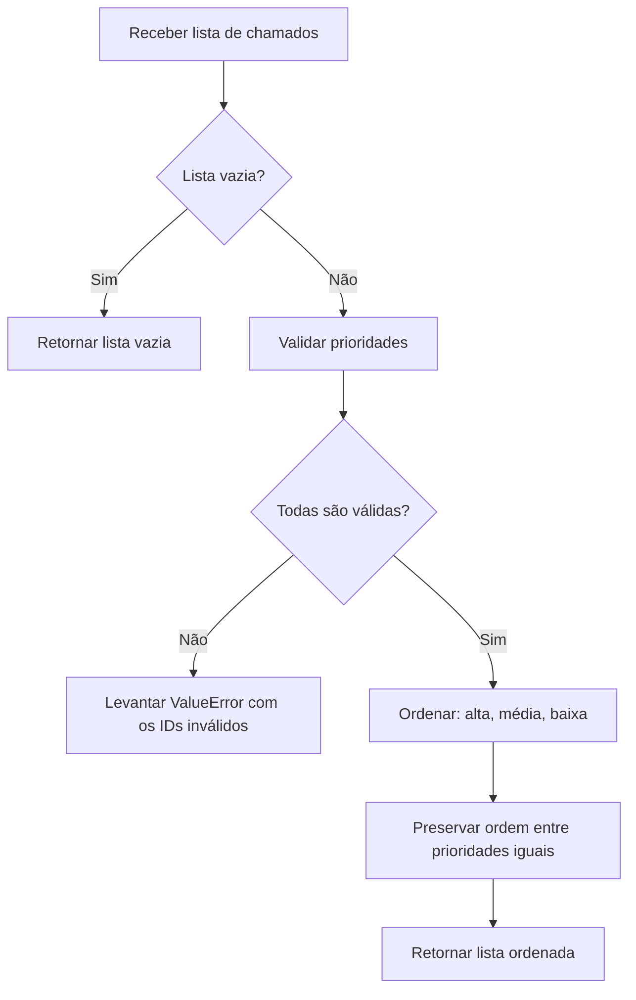

# Chamados — ordenação por prioridade

Biblioteca Python pequena para ordenar uma lista de chamados por prioridade, mantendo a ordem original entre chamados com a mesma prioridade.

## Contrato

As prioridades válidas e sua ordem são:

| Prioridade | Ordem |
| --- | ---: |
| `alta` | 1ª |
| `média` | 2ª |
| `baixa` | 3ª |

A função `ordenar_chamados`:

- devolve os chamados ordenados por prioridade;
- preserva os dados e a ordem relativa dos chamados com prioridades iguais;
- devolve `[]` quando recebe uma lista vazia;
- levanta `ValueError` quando há prioridades desconhecidas, identificando os IDs inválidos. A mensagem é singular para um chamado inválido e plural para vários.

## Fluxo



## Requisitos

- Python 3.9 ou superior.
- A implementação usa apenas a biblioteca padrão do Python. `pytest` é necessário para executar os testes.

## Instalação do ambiente de testes

Na raiz do repositório:

```bash
python3 -m venv .venv
source .venv/bin/activate
python -m pip install pytest
```

## Executar os testes

```bash
python -m pytest -q
```

## Exemplo de uso

Com a raiz do repositório no caminho de importação:

```python
from chamados import ordenar_chamados

chamados = [
    {"id": 1, "nome": "Acompanhar solicitação", "prioridade": "baixa", "status": "aberto"},
    {"id": 2, "nome": "Falha de acesso", "prioridade": "alta", "status": "aberto"},
    {"id": 3, "nome": "Atualizar cadastro", "prioridade": "média", "status": "aberto"},
]

ordenados = ordenar_chamados(chamados)
# IDs na ordem: 2, 3, 1
```

Prioridades desconhecidas produzem um erro. Por exemplo, para um chamado inválido de ID `42`, a mensagem é `Prioridade inválida para o chamado com id 42.`
